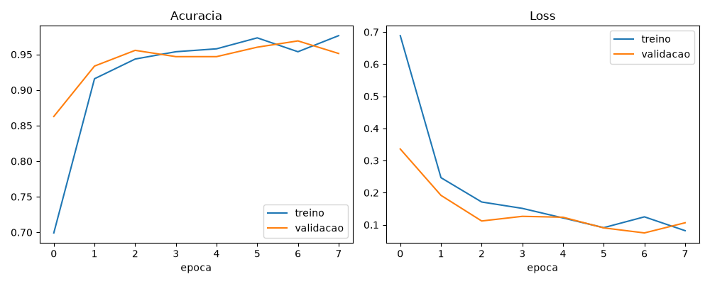

# Reconhecimento de Pokémon com CNN (sem webcam)

Classifica qual Pokémon aparece em uma foto ou em um vídeo. Esta versão foi treinada **só com imagens baixadas da internet**, sem gravar vídeos com webcam, e já traz o modelo treinado (`modelo.keras`). Assim dá para reconhecer os Pokémon num PC sem câmera: basta abrir fotos ou vídeos.

## Pokémon usados

| Classe | Pokémon | O que diferencia |
| --- | --- | --- |
| `pikachu` | Pikachu (nº 25) | Amarelo, orelhas pontudas com a ponta preta, rabo em forma de raio |
| `charmander` | Charmander (nº 4) | Laranja, chama na ponta do rabo |
| `squirtle` | Squirtle (nº 7) | Azul-claro, casco marrom |
| `fundo` | Nenhum dos 3 | 12 outros Pokémon e 12 imagens vazias |

Os três foram escolhidos por serem os mais fáceis de separar: cada um tem uma cor dominante diferente (amarelo, laranja e azul) e uma silhueta bem distinta. Também existem muitas imagens oficiais de cada um.

A classe `fundo` ensina o modelo a responder "nenhum dos 3". Ela tem Bulbasaur, Jigglypuff, Psyduck, Meowth, Gengar, Magikarp, Eevee, Snorlax, Pidgey, Oddish, Mew e Lapras, além de imagens sem Pokémon (branco, cores lisas, degradês e ruído).

## Métodos de treinamento

### Dados

- **Fonte:** [PokeAPI](https://pokeapi.co), gratuita e sem cadastro. O script `baixar_pokemons.py` baixa a arte oficial, os renders do Pokémon HOME e os sprites dos jogos (gerações I a IX), incluindo sprites de costas e GIFs animados.
- **O que fica de fora:**
  - versões *shiny*, porque mudam a cor (o Charmander shiny é amarelo, parecido com o Pikachu);
  - sprites em preto e branco (*gray*);
  - variações de fêmea, quase iguais às normais;
  - ícones minúsculos;
  - imagens `.svg`.
- **Classe `fundo`:** 5 imagens sorteadas de cada um dos 12 Pokémon, com semente fixa.
- **GIFs animados:** até 4 quadros espalhados pela animação, todos no mesmo grupo.
- **Imagens repetidas:** cada imagem é reduzida a 32×32 e descartada se for quase igual a outra já salva da mesma classe (diferença média menor que 4).

| Classe | Imagens | Treino | Validação |
| --- | --- | --- | --- |
| `charmander` | 79 | 65 | 14 |
| `fundo` | 104 | 85 | 19 |
| `pikachu` | 96 | 80 | 16 |
| `squirtle` | 86 | 72 | 14 |
| **Total** | **365** | **302** | **63** |

### Preparação das imagens

A mesma função prepara a imagem no treino e na detecção (`ler_imagem` e `letterbox`, em `utils.py`):

1. Imagens transparentes (PNG/WEBP) são recortadas no contorno do Pokémon e ganham fundo branco.
2. A imagem é redimensionada para 224×224 sem distorcer, com bordas pretas onde sobrar espaço.

### Divisão entre treino e validação

Cada imagem (ou GIF) forma um grupo, e 20% dos grupos de cada classe vão para a validação. O grupo inteiro vai só para o treino ou só para a validação, com semente 42. É a mesma regra que o projeto usa para vídeos: assim nenhum quadro de um mesmo GIF fica dos dois lados e infla a acurácia.

### Modelo

- **Transfer learning** com a MobileNetV2 pré-treinada na ImageNet. A base fica congelada e só a camada final é treinada.
- **Cabeça:** `GlobalAveragePooling2D`, depois `Dropout(0.3)` e `Dense(4, softmax)`.
- **Data augmentation** (só no treino): espelhamento horizontal, rotação de 10%, zoom de 20%, deslocamento de 10%, brilho de 25% e contraste de 25%.
- **Treino:** otimizador Adam (taxa 0,001), loss `sparse_categorical_crossentropy`, lotes de 16 e até 8 épocas. O `EarlyStopping` monitora a loss de validação (paciência 3) e restaura os melhores pesos.
- **Ambiente:** Python 3.12, TensorFlow 2.21 (Keras 3) e OpenCV, só com CPU.

### Resultados

Acurácia de validação: **82,54%**.

Matriz de confusão (linhas = real, colunas = previsto):

| | charmander | fundo | pikachu | squirtle |
| --- | --- | --- | --- | --- |
| **charmander** | 14 | 0 | 0 | 0 |
| **fundo** | 4 | 14 | 1 | 0 |
| **pikachu** | 3 | 1 | 12 | 0 |
| **squirtle** | 1 | 1 | 0 | 12 |

| Classe | Precisão | Recall |
| --- | --- | --- |
| `charmander` | 63,64% | 100,00% |
| `fundo` | 87,50% | 73,68% |
| `pikachu` | 92,31% | 75,00% |
| `squirtle` | 100,00% | 85,71% |



Testes com imagens que não estavam no treino do jeito que foram testadas:

| Imagem | Resultado |
| --- | --- |
| Pikachu fêmea (render do HOME) | pikachu, 72% |
| Arte oficial do Charmander sobre fundo verde | charmander, 55% |
| Arte oficial do Squirtle sobre fundo bege | squirtle, 75% |
| Imagem em branco | nenhum dos 3, 91% |
| Raichu | pikachu, 54% (erro) |

A arte oficial do Charmander e a do Squirtle estão no treino, mas só com fundo branco. O Raichu sai como Pikachu porque é parecido e não faz parte do treino. Para corrigir, coloque imagens dele em `imagens/fundo/`.

## Como usar

### Instalação

Use o **Python 3.12**: o TensorFlow ainda não instala no Python 3.14. Rode os comandos na raiz do projeto.

**Windows (PowerShell):**

```powershell
py -3.12 -m venv .venv
.venv\Scripts\Activate.ps1
pip install tensorflow opencv-python numpy matplotlib pillow
```

**Linux/macOS:**

```bash
python3.12 -m venv .venv
source .venv/bin/activate
pip install tensorflow opencv-python numpy matplotlib pillow
```

Um modelo salvo com o TensorFlow 2.21 pode não abrir em versões antigas, como a 2.15. Se `detectar_imagem.py` der erro ao carregar o `modelo.keras`, atualize o TensorFlow ou treine de novo.

### Reconhecer Pokémon (não precisa treinar)

O modelo já está pronto no repositório.

```bash
python detectar_imagem.py foto.png      # uma foto
python detectar_imagem.py teste/        # todas as fotos da pasta
python detectar.py meu_video.mp4        # um vídeo
```

O `detectar_imagem.py` abre uma janela por foto (qualquer tecla passa para a próxima, `q` sai) e salva cada foto com o resultado em `resultados/`. Para não abrir janela, defina `MOSTRAR=0` (no PowerShell: `$env:MOSTRAR=0`).

### Treinar de novo

```bash
python baixar_pokemons.py   # baixa as imagens para imagens/ e gera data/
python train.py             # gera modelo.keras, class_names.json e curvas.png
```

A internet só é necessária na primeira vez. Para melhorar o modelo, coloque fotos suas (do Google, prints do anime, fotos de pelúcia...) em `imagens/<classe>/` e rode os dois comandos de novo. O que já foi baixado não é baixado outra vez.

### Treinar só com modelos 3D

```bash
python baixar_modelos.py    # renders 3D em modelos_3d/, cenários em cenarios/, gera data/
python train.py
```

O `baixar_modelos.py` baixa da PokeAPI só os renders 3D (Pokémon HOME, Let's Go, Sword/Shield, BDSP, Legends Arceus, Scarlet/Violet, Legends Z-A e Champions), de frente e de costas, e descarta os que têm menos de 200 px. Também baixa 150 fotos aleatórias do [picsum.photos](https://picsum.photos) para servir de cenário. Cada imagem de `data/` é um modelo colado sobre um cenário sorteado, com tamanho, posição e formato de tela (1:1, 4:3, 16:9 ou 3:4) aleatórios. Na classe `fundo`, 25% das imagens são só o cenário. São 400 imagens por classe (`IMAGENS_POR_CLASSE`).

Para melhorar a detecção:

- **`modelos_3d/<classe>/`**: coloque mais renders. PNG transparente é colado nos cenários. Print de jogo ou foto sem transparência entra do jeito que está.
- **`cenarios/`**: coloque fotos do lugar onde o modelo vai ser usado.

O treino com vídeos continua funcionando como antes: coloque os vídeos em `videos/<classe>/` e rode `python extrair_frames.py` antes do `train.py`.

### Ajustes

| Script | Constante | Padrão | O que controla |
| --- | --- | --- | --- |
| `baixar_pokemons.py` | `CLASSES` | 3 Pokémon e `fundo` | Quais Pokémon baixar em cada classe |
| `baixar_pokemons.py` | `MAX_POR_POKEMON_FUNDO` | 5 | Imagens de cada Pokémon da classe `fundo` |
| `baixar_pokemons.py` | `QUADROS_POR_GIF` | 4 | Quadros aproveitados de cada GIF |
| `baixar_pokemons.py` | `DIFF_MINIMA` | 4.0 | Diferença mínima para não descartar como repetida |
| `train.py` | `EPOCHS` | 8 | Número máximo de épocas |
| `train.py` | `VAL_FRACTION` | 0.2 | Fração dos grupos usada na validação |

## Arquivos

| Arquivo | Conteúdo |
| --- | --- |
| `modelo.keras` | Modelo treinado |
| `class_names.json` | Nomes das classes, na ordem usada pelo modelo |
| `curvas.png` | Curvas de acurácia e loss do treino |
| `baixar_pokemons.py` | Baixa as imagens e gera `data/` |
| `train.py` | Treina o modelo |
| `detectar_imagem.py` | Reconhece Pokémon em fotos |
| `detectar.py` | Reconhece Pokémon em vídeos ou na webcam |
| `extrair_frames.py` | Gera `data/` a partir de vídeos (treino com webcam) |
| `utils.py` | Preparação das imagens, igual no treino e na detecção |

As pastas `imagens/`, `data/` e `resultados/` são geradas pelos scripts e ficam fora do git (`.gitignore`).
